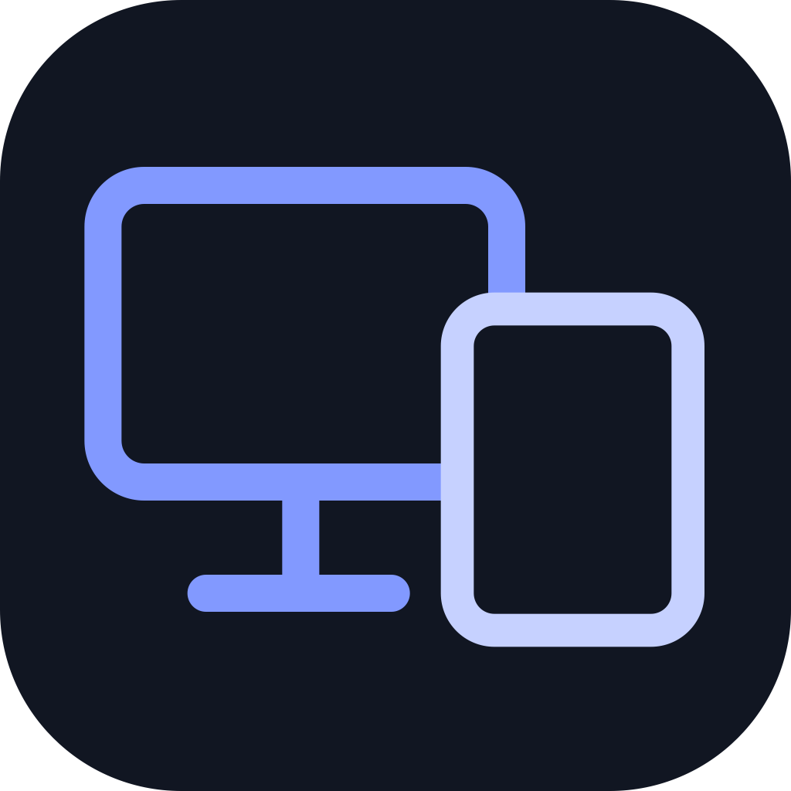

<p align="center"></p>

# 连屏 LinkDesk

通过 USB 将 MatePad 用作 Mac 的独立扩展屏幕，并使用平板扬声器和麦克风。当前版本 **0.6.4**，面向 Apple Silicon Mac；Mac mini 已实机确认画面、扬声器和麦克风可用。

| 版本 | 获取方式 | 说明 |
| --- | --- | --- |
| Mac mini 新版 0.6.4 | main / v0.6.4 | 平板麦克风回传、新图标、发行与 Homebrew 支持 |
| MacBook 原版 0.5.2 | legacy/macbook / macbook-v0.5.2 | 保留原始源码和原图标，无平板麦克风回传；不自动替换为新版 |

两个版本使用相同应用标识，不应在同一台 Mac 同时运行。保留原 MacBook 应用和证书即可继续使用原版；GitHub 原版标签可用于恢复源码。MacBook 归档来自 2026-09-09 项目目录的本地快照，未重新验证原版二进制。

## 准备

- Apple Silicon Mac，macOS 14 或更新；新版目前只在 Mac mini 上完成验证，Intel 不提供预编译包。
- MatePad + 可传输数据的 USB 线；原项目针对 HarmonyOS 6.1 平板开发。
- Mac 安装华为 DevEco Studio（默认路径 `/Applications/DevEco-Studio.app`），以提供 HDC USB 调试工具。公开包不捆绑华为 SDK 工具。
- 在平板开发者选项开启 USB 调试并允许此 Mac。
- 平板应用需在 DevEco Studio 中配置**自己的调试签名**后构建安装。调试 HAP 与获授权设备绑定，因此不公开发布仅适用于开发者个人平板的 HAP。

## 安装 Mac

从 [Releases](https://github.com/wwwwzzzzkkkk/LinkDesk/releases) 下载 `LinkDesk-0.6.4-macos-arm64.zip`，解压后在该文件夹运行：

```sh
bash scripts/install-mac.sh LinkDesk.app
```

应用安装到 `/Applications/LinkDesk.app`。安装脚本会校验签名并备份旧应用。公开发行使用固定本地开发证书签名，**尚未经过 Apple Developer ID 公证**；首次打开可能需在系统设置“隐私与安全性”中确认打开。

如果已有旧 MacBook 签名的应用，默认安装会阻止更换签名。希望保留旧版时不要迁移；确实要升级时，备份旧版和证书后显式运行：

```sh
LINKDESK_ALLOW_SIGNER_MIGRATION=1 bash scripts/install-mac.sh LinkDesk.app
```

更换签名后需重新授权录屏。同一证书更新不重置权限。不要用直接拷贝覆盖绕过此检查。

### Homebrew

```sh
brew tap wwwwzzzzkkkk/linkdesk
brew install --cask wwwwzzzzkkkk/linkdesk/linkdesk
```

更新：`brew update && brew upgrade --cask linkdesk`。已有手动安装的应用不需重新安装；不要使用 `--force` 接管现有应用。Cask 使用同一安装脚本，签名发生变化会停止升级。保留 MacBook 旧版时无需安装此 Cask。

### 音频驱动（首次安装）

平板扬声器和麦克风需要 LinkDesk 的 Core Audio 插件。下载包在解压目录运行：

```sh
python3 scripts/authorize-audio-driver-install.py
```

Homebrew 用户运行：

```sh
python3 "$(brew --caskroom)/linkdesk/0.6.4/LinkDesk/scripts/authorize-audio-driver-install.py"
```

系统会请求管理员授权，安装三个 LinkDesk 插件并短暂重启音频服务。请先结束通话。插件安装到 `/Library/Audio/Plug-Ins/HAL`，安装脚本保留旧插件备份。卸载应用时插件会保留，移除方法见 [安装说明](docs/INSTALL.md)。

## 使用

1. 用数据线连接平板，打开平板“连屏”，允许 USB 调试。
2. 在 Mac“系统设置 → 隐私与安全性 → 屏幕与系统音频录制”允许 LinkDesk，然后按提示退出重开。
3. 在 Mac 连屏窗口启动副屏；通过 Mac“显示器”设置排列屏幕位置。
4. 点“使用平板扬声器”；点“恢复 Mac 扬声器”可切回原输出。
5. 平板点击“允许 Mac 使用平板麦克风”，允许麦克风权限；画面全屏时轻点打开控制面板。
6. Mac 勾选**“使用平板麦克风作为 Mac 输入”**。状态应显示“已设为 Mac 输入”。会议软件内选择 **MatePad 麦克风（连屏）**。

麦克风每次启动默认关闭，必须两端都开启。平板进入后台会停止拾音，返回后需重新开启。断线、关闭或退出时恢复原输入；若原输入不存在，需手动选择可用输入。音频实时传输，不保存录音文件。

### 常见问题

- 已允许平板麦克风却没声音：检查 Mac 的麦克风复选框，再检查会议软件输入设备。
- 每次要求录屏授权：确认正在打开 `/Applications/LinkDesk.app`，保留相同签名；迁移证书时使用安装脚本，勿反复重新签名或覆盖安装。
- USB 未就绪：确认数据线支持数据、平板允许调试、DevEco Studio 安装到默认路径且只连接一台目标平板。
- 新图标未刷新：退出并重新打开应用，Dock 中移除旧快捷方式再重新加入。

## 构建

安装 Xcode Command Line Tools：`xcode-select --install`。正式更新需自己的固定代码签名证书；私钥仅保留在本机钥匙串。

```sh
LINKDESK_SIGN_IDENTITY="你的签名证书名称或 SHA-1" LINKDESK_BUNDLE_HDC=0 bash scripts/build-mac.sh
LINKDESK_SIGN_IDENTITY="你的签名证书名称或 SHA-1" bash scripts/build-audio-driver.sh
```

Mac 测试包可用 `LINKDESK_SIGN_IDENTITY=-` 临时签名构建，但安装脚本拒绝用临时签名覆盖已授权应用。平板：DevEco Studio 打开 `HarmonyOS/`，配置个人签名后运行 `bash scripts/build-harmony.sh`。支持 `LINKDESK_DEVECO_HOME` 和 `LINKDESK_HARMONY_BUILD_ROOT`。

[版本与发布流程](docs/RELEASING.md) · [更新记录](CHANGELOG.md) · [安装与卸载](docs/INSTALL.md) · [图标设计](assets/README.md)

## 许可证与第三方代码

项目以 GPL-3.0 发布，见 [LICENSE](LICENSE)。音频驱动衍生自 [BlackHole](https://github.com/ExistentialAudio/BlackHole)，保留版权、许可证、固定上游版本及修改说明，见 `macOS/AudioDriver/vendor/`。华为 DevEco/HDC 由用户自行获取，受其许可条款约束；不包含在公开源码或发行包中。

Homebrew 配置依据 [官方 Cask 文档](https://docs.brew.sh/Cask-Cookbook)。

本机 USB 工具也可保留于 `~/Library/Application Support/LinkDesk/tools/`（hdc 与其 libusb_shared.dylib 配套），新版会在未捆绑工具时优先尝试此目录；这些 SDK 工具不进入公开发行包。运行中的 Dock 图标直接使用平板原图，Finder 仍可能按 macOS 系统样式添加光影。
