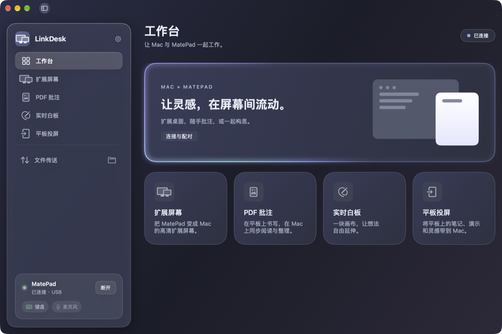
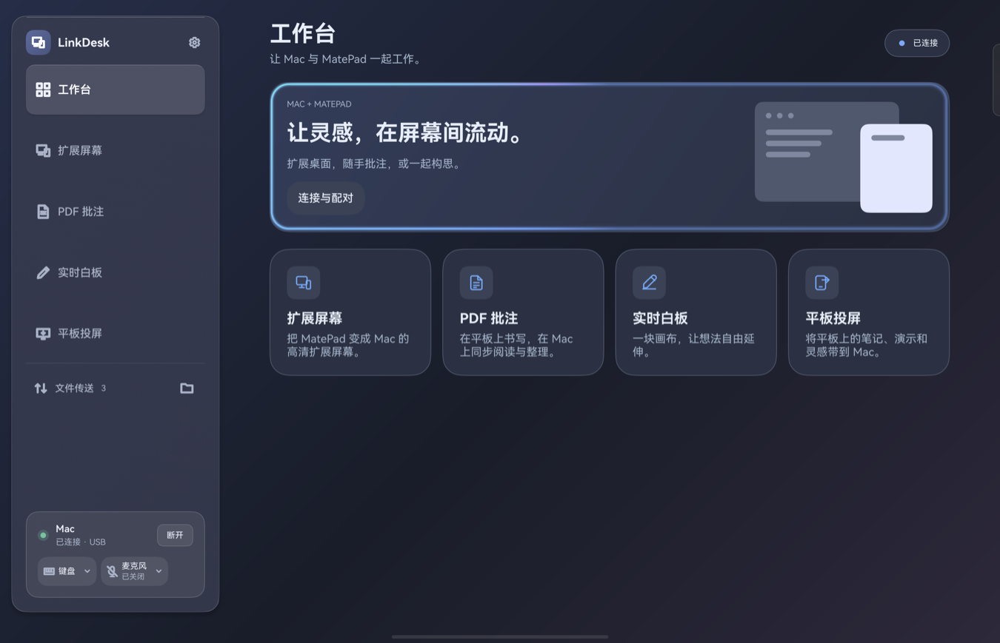

# LinkDesk 1.5.0

Mac 和 MatePad 可以从系统分享菜单互传文件。平板麦克风可独立用于 Mac 通话，两个工作台也会各自显示当前的连接状态。

## 新增功能

- **系统文件互传**。Mac 可从「访达 → 共享 → 发送到 LinkDesk」或左侧栏拖拽发送，MatePad 可在系统分享菜单选「发送到 Mac」。完成配对后，文件传送优先使用 USB，同一局域网内有可用 Wi-Fi 时可切换。单个文件最大 64 MB。
- **后台收件与保存**。MatePad 在「文件传送」开启后台收件通知后，可以从通知打开文件或选择保存位置。Mac 收件可选择保存位置，也可以晚些从侧栏处理。现有文件仍可在各端收件入口查看。
- **华为笔记往返**。将 PDF 发到平板后选择用华为笔记批注，再从系统分享回传批注副本，保留 Mac 上的原件。PDF 批注、实时白板和平板投屏仍有独立入口。
- **无线麦克风**。MatePad 可从左下角设备卡或通知快捷操作开启麦克风，并通过 Wi-Fi 给 Mac 提供音频输入。USB 可用时优先走 USB。其他应用获得麦克风时 LinkDesk 会暂停，系统允许继续录音后恢复。用户手动关闭后保持关闭。需要平板录音权限及 Mac 音频插件。
- **投屏识题（实验功能）**。可在 Mac 框选镜像中的题目，手动或自动截取，查看答案和简短理由。已收录的同题优先复用本地答案。可按需「搜原题」，超时或信心不足时也会尝试搜索，匹配到有可核对答案的原题时优先展示。解题和搜索需使用对应服务或配置，选区图像可能发送给所选服务，模型、网络和题目来源会影响结果。

## 改进和修复

- 两端工作台同步呈现连接徽标和 USB 或 Wi-Fi，连接时出现冷色光晕。新侧栏把连接、键盘与麦克风放入同一张设备卡，文件入口随连接状态变化。
- Mac 主程序退出、失去响应或网络中断后，平板会更新为「未连接」，后台收件状态也会切换为等待重连。Mac 仅关闭显示器且 LinkDesk 仍能响应时，连接可继续使用。
- 键盘通知保留快捷入口。麦克风会定期确认 Mac 可用。Mac 断开时，平板停止采集并清理正在发送的提示。后台收件和麦克风分别向系统申请后台运行。
- 连接后平板直接进入 PDF 或白板画布，减少顶部的标题和配对提示，保留底部浮动工具栏及系统手势区。窗口缩放期间减少部分动效，Mac 滚动边缘采用柔和过渡，工具栏与窗口背景融为一体。
- USB 拔出后停止失去平板的虚拟显示会话。新版扩展屏幕启动时默认启用平板麦克风，在画质或帧率重建会话时保留当前开关状态。

## 应用截图

**Mac 工作台和设备侧栏**

**MatePad 工作台与连接状态**

## 验证记录

- Mac mini 显示器实际息屏时，LinkDesk 仍能响应。单独暂停或结束 Mac 主程序时，平板首页会在数秒内显示未连接，即使转发服务尚在运行。恢复或重开主程序后，用原配对恢复连接。
- 在 MatePad 检查了后台收件状态、USB 文件到达通知、键盘快捷通知和麦克风开关，收件和录音通知能同时出现。暂停 Mac 主程序后，录音提示消失，平板设备卡显示麦克风已关闭。检查了白板浮动工具栏和双端工作台。
- 66 项协议和功能回归通过，包括 Mac 主程序停止后的状态测试。原生音频、输入、视频格式及帧调度回归通过。

## 安装与适用范围

- 本次 GitHub 发布包含 Apple Silicon Mac 安装包、SHA-256 校验文件及两端源码。Homebrew 安装可从项目的 Cask 更新。
- 平板需用 DevEco Studio 为设备签名和安装，个人签名 HAP 无法跨设备分发。建议两端一起升级。Mac 包沿用固定开发证书，尚无 Developer ID 公证。
- 后台收件依赖 HarmonyOS 允许后台运行。系统暂停应用后，需要返回 LinkDesk 继续收件。扩展屏幕和平板投屏使用 USB。已在 Mac mini 和 MatePad 上检查主要流程，MacBook 合盖睡眠、长时间待机，以及持续高刷新率未作本轮专项测试。

[安装与卸载](INSTALL.md)
